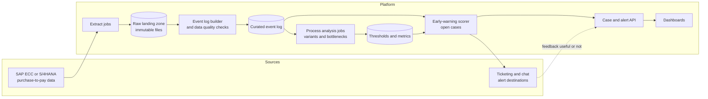
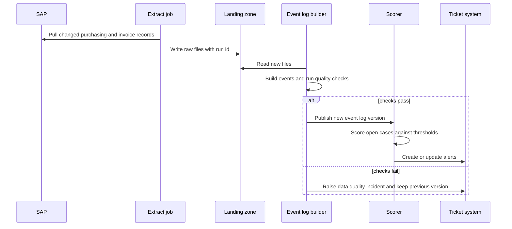
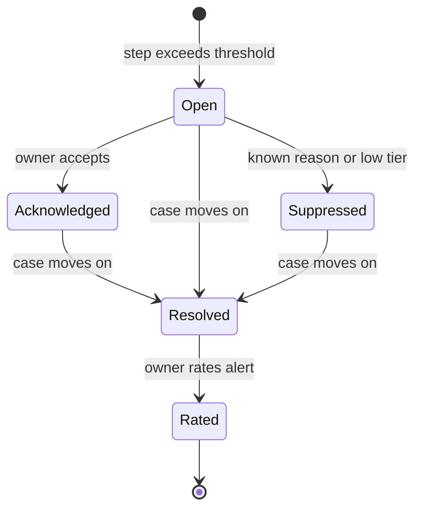

# Design: Production Process Mining and Early Warning

## 1. Purpose and status
This document describes how a purchase-to-pay (P2P) process mining and early-warning prototype could become a production system. It is a design proposal. The prototype ([p2p-process-mining](https://github.com/OK-22/p2p-process-mining)) is the only implemented part, and it runs on simulated data. Every target, volume, and cost below is a proposal or an assumption to be confirmed with stakeholders.

## 2. Problem and goals
Late invoices and slow goods-receipt matching cost money through missed early-payment discounts, late-payment penalties, and strained supplier relationships. Teams usually find out about a late case when a supplier complains, not while it can still be fixed.

**Goals**
1. Build a trustworthy event log of the P2P process from ERP data, refreshed on a regular schedule.
2. Show where cases wait, by step, vendor, and company code.
3. Warn the right person while a case can still be saved, with few enough false alarms that people keep reading the alerts.
4. Keep an audit trail: for any alert, show which data and which threshold produced it.

**Non-goals (first release)**
- Automatically changing anything in the ERP system. The system reads and advises.
- Predicting cases with machine learning (see ADR 0003).
- Real-time streaming (see ADR 0001).
- Processes other than P2P.

## 3. Users and use cases
| User | Need |
|---|---|
| Accounts payable team lead | A short daily list of cases at risk of paying late, with the reason |
| Procurement manager | Which vendors and steps cause the most waiting |
| Process owner | Trend of waiting times and rework, to judge whether fixes work |
| Internal audit | Evidence that alerts and numbers can be traced to source data |
| Platform operator | Clear signals when a data load fails or a job is stale |

## 4. Requirements
**Functional**
- Extract purchasing, goods receipt, and invoice data on a schedule.
- Build an event log with one row per event: case, activity, timestamp, resource, and attributes.
- Compute step durations and thresholds per segment (for example per vendor group).
- Score open cases against the thresholds and create alerts with an owner.
- Collect feedback on each alert (useful or not) and report alert quality.
- Provide dashboards and an API for case detail.

**Non-functional (proposed targets, to be agreed)**
| Quality | Proposed target |
|---|---|
| Data freshness | Event log refreshed at least daily; new data visible within 4 hours of the extract finishing |
| Alert latency | Alert created within 1 hour of the event log refresh |
| Availability | Analysis and alerting 99 percent during business hours; a missed refresh does not lose data |
| Reproducibility | Any past event log version can be rebuilt from stored raw extracts |
| Alert quality | Measured monthly. Initial goal: better than the prototype's 31 percent precision, with the final target set once real data exists |
| Security | Least privilege, encryption in transit and at rest, no write access to the ERP |

## 5. Architecture overview

| Component | Responsibility |
|---|---|
| Extract jobs | Read changed purchasing and invoice records from the ERP using a supported interface; write raw files with a run identifier |
| Raw landing zone | Immutable storage of every extract, never edited (ADR 0002) |
| Event log builder | Turn raw records into events, run data quality checks, publish a versioned event log only if checks pass |
| Curated event log | Columnar files or a warehouse table, versioned |
| Process analysis jobs | Compute variants, step durations, rework, and thresholds per segment on a schedule |
| Early-warning scorer | Compare each open case's current wait with the threshold for its segment and step |
| Case and alert API | Serve case history, alert state, and feedback to dashboards and tickets |
| Dashboards | Process health, vendor and step breakdowns, alert quality over time |

**Daily cycle**

A failed data quality check keeps the previous event log and raises an incident. Alerting on stale or wrong data is worse than not alerting.

## 6. Data design
**Sources (typical, to be confirmed against the actual system).** In an ECC system, purchase order headers and items are usually in the EKKO and EKPO tables, purchase order history (goods and invoice receipts) in EKBE, material documents in MKPF and MSEG, invoice documents in RBKP and RSEG, accounting documents in BKPF and BSEG, vendors in LFA1, and change documents in CDHDR and CDPOS. S/4HANA changes some of these (material documents move to MATDOC, and accounting to the universal journal ACDOCA), so the extraction layer must be written per system version. Extraction can use the ERP's supported replication or extraction interfaces rather than direct table reads where the client allows it.

**Case definition.** One case is one purchase order item. This is a design choice with trade-offs: a purchase order can have many items and an invoice can cover many orders, so the event log builder must document how it handles partial deliveries and multi-order invoices.

**Event log schema**
| Column | Meaning |
|---|---|
| case_id | Purchase order number plus item |
| activity | For example Create Purchase Order Item, Record Goods Receipt, Record Invoice Receipt, Clear Invoice |
| event_time | Timestamp of the activity, in one agreed time zone |
| resource | User or system that performed it, subject to the privacy rules in section 8 |
| attributes | Vendor, company code, amount band, material group, and similar |
| source_run_id | The extract run that produced the row, for traceability |

**Data quality checks (a failed check blocks publication)**
- Row counts within an expected range compared with the previous run
- No events with timestamps in the future, or before the order existed
- Every case has a creation event
- Share of cases missing the expected activity order stays within a limit
- Duplicate events are detected and removed with a count logged

**Retention.** Raw extracts are kept long enough to rebuild any event log version needed for audit. The period is set by the client's retention policy, not by this design.

## 7. Early-warning design
**Version 1: threshold rule (from the prototype).** For each pair of consecutive activities, learn the 90th percentile of the waiting time from past closed cases. An open case triggers an alert when its current wait at a step passes that threshold. In the prototype this gave 98 percent recall and 31 percent precision on a 30 percent holdout of simulated cases, with a median warning of 67 days. Those numbers describe simulated data only.

**Controlling false alarms.** About 2 in 3 of the prototype's alerts were false, so the design adds controls from the start:
1. **Segmented thresholds.** Learn thresholds per vendor group or company code, because one global percentile punishes slow-by-nature segments.
2. **Alert tiers.** Separate "watch" (past the 90th percentile) from "act" (past a higher percentile, or large amount, or an early-payment discount at risk). Only the act tier creates a ticket.
3. **Suppression.** Do not alert on cases with a recorded known reason (for example a blocked invoice already under review) or already alerted within a set window.
4. **Ownership.** Every alert goes to a named queue so it is not everyone's problem.
5. **Feedback.** Each alert carries a useful or not useful rating. Monthly, report precision by segment and retune thresholds.

**Alert lifecycle**

**Version 2: learned model (later).** Once there is real data and a few months of rated alerts, test a supervised model that predicts lateness from case attributes and progress. It would replace the rule only if it beats the rule on a held-out period, and its explanations must be good enough for an alert to say why (ADR 0003). The prototype's ticket-classification service shows the evaluation habit to reuse: judge on data written or collected separately from the training data, and report the gap.

**How alert quality is measured**
- Precision: share of alerts rated useful.
- Recall: share of late cases that had an alert in advance.
- Lead time: days between the alert and the due date.
- Alert volume per owner per week, because a precise system that sends 200 alerts a day still fails.

## 8. Security and compliance
- **Read-only access** to the ERP through a dedicated service account with the minimum authorizations, reviewed by the ERP security team.
- **Encryption** in transit and at rest for the landing zone, event log, and backups.
- **Least privilege** for every component: the scorer can read the event log and write alerts, nothing more.
- **Sensitive fields.** The resource (user) column is personal data. Options are to pseudonymize it in the event log and keep the lookup in a separate, restricted store. The choice depends on local privacy rules and works councils, and must be decided with the client before the first extract.
- **Financial data.** Amounts and vendor details are business-sensitive. Dashboard access follows the same segregation as the source system (for example by company code).
- **Audit trail.** Every alert stores the event log version, the threshold value, and the rule version that created it.
- **Secrets** live in a managed secret store, never in code or images.

## 9. Operations
- **Deployment.** Containerized jobs and services, built and tested in a CI pipeline, with infrastructure described as code. The pattern is the one shown in [cloud-pipeline](https://github.com/OK-22/cloud-pipeline).
- **Monitoring.** Metrics and alerts on the platform itself: last successful extract, event log age, check failures, scorer duration, API errors. The approach and alert rules are the ones practiced in [monitoring-homelab](https://github.com/OK-22/monitoring-homelab).
- **Runbooks.** One per platform alert, in the style of that repository's runbook: what it means, how to check, how to fix, when to escalate.
- **Failure handling.** Extract jobs are idempotent, so a rerun with the same run id replaces rather than duplicates. A failed refresh keeps the last good event log.
- **Backups and recovery.** Raw extracts are the system of record for rebuilds. Recovery means redeploying the code and replaying extracts.
- **Change control.** Threshold rules are versioned. A change goes through review and shows its effect on past data before it goes live.

## 10. Sizing and cost (illustrative assumptions)
These figures are assumptions for reasoning, not measurements.
- **Volume:** suppose 500,000 purchase order items a year with about 5 events each, roughly 2.5 million events a year. In columnar format that is small enough for a single modest database or file-based analytics engine.
- **Compute:** daily batch jobs run for minutes to low hours. A small container host or scheduled serverless jobs would likely be enough, so cost is dominated by people and licenses, not infrastructure.
- **Cost drivers to confirm:** ERP extraction licensing, process mining platform license if bought (ADR 0004), storage retention, and support staffing.
- **Scaling path:** if volume grows a hundredfold or freshness must drop to minutes, revisit ADR 0001.

## 11. Rollout plan
| Phase | Scope | Exit criteria |
|---|---|---|
| 0. Discovery | Confirm ERP version, data access route, case definition, privacy rules, owners | Signed-off data access and case definition |
| 1. Measure on real data | Extract, build the event log, run the prototype rule in shadow mode (no tickets) | Data quality checks pass for 4 weeks; real precision and recall measured and shared |
| 2. Pilot alerts | One company code or vendor group, act-tier alerts to one queue, feedback enabled | Precision and alert volume acceptable to the owning team for 6 weeks |
| 3. Expand | More segments, dashboards for procurement and process owners | Owners adopt the dashboards; feedback loop used monthly |
| 4. Improve | Test a learned model or streaming only if the data justifies it | Beats the rule on a held-out period |

## 12. Risks and open questions
| Risk or question | Why it matters | Response |
|---|---|---|
| Real precision is worse than the prototype | Teams stop reading alerts | Shadow mode first, segmented thresholds, tiers, feedback |
| Case definition does not fit the business (multi-order invoices, partial deliveries) | Wrong waiting times | Settle in Phase 0, test with process owners |
| ERP extraction is slow or restricted | Delays the whole plan | Confirm access route and load limits in Phase 0 |
| Resource data conflicts with privacy rules | Blocks the project | Pseudonymize by default, decide with the client early |
| Dashboards disagree with finance numbers | Loses trust | Reconcile counts against source reports in Phase 1 |
| Open: is a commercial mining platform already licensed? | Changes build versus buy | See ADR 0004 |
| Open: who owns each alert queue? | An alert without an owner is noise | Name owners in Phase 0 |

## 13. Appendix: possible cloud mapping
This is a reference mapping, not a statement of experience with every service.
| Need | AWS example |
|---|---|
| Raw landing zone | S3 with versioning |
| Scheduled extract and build jobs | ECS tasks or Lambda on a schedule, orchestrated by Step Functions or a similar scheduler |
| Event log and analytics | Parquet files in S3 queried with Athena, or a managed warehouse |
| Alert delivery | SNS or EventBridge to the ticketing and chat tools |
| API and dashboards | A small container service behind a load balancer, plus a dashboard tool |
| Secrets and keys | Secrets Manager and KMS |
| Monitoring | CloudWatch, or the Prometheus and Grafana approach used in the monitoring repository |
| Infrastructure as code | Terraform, as in the cloud-pipeline repository |
